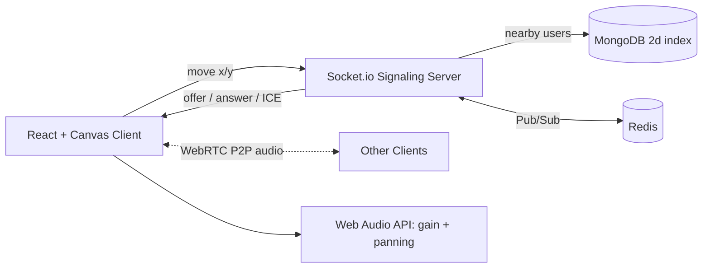

<div align="center">

# 🎧 ProxiSpeak

### Geospatial Proximity Audio Ecosystem

*Walk close to hear people. Walk away and they fade out, just like a real office.*


**Infotact Solutions Internship Project | Group 10**

</div>

---

## 📖 About

Remote tools like Zoom put everyone into rigid "rooms" where only one person can speak at a time. They miss the spontaneity of a real office, where you overhear nearby chats and walk over to join one.

**ProxiSpeak** is a 2D virtual office. You move your avatar around a map, and the audio of people nearby gets louder as you approach and quieter as you leave. It supports 50+ users in the same space.

## ✨ Features

| | Feature | Description |
|---|---|---|
| 🗺️ | **2D Virtual World** | Overhead office map drawn with React and HTML5 Canvas, with smooth avatar movement |
| 📍 | **Geospatial Engine** | MongoDB `$near` and `$geoWithin` queries find who is within earshot (100 px) |
| 📡 | **Signaling Server** | Node.js and Socket.io set up WebRTC handshakes only between nearby users |
| 🔊 | **Spatial Audio Mixer** | Web Audio API adjusts volume (gain) and left/right panning from avatar distance |
| 🧱 | **Obstacles Block Sound** | Furniture and walls saved in MongoDB reduce audio between avatars |
| 🚀 | **Scales Out** | Redis Pub/Sub lets several Node instances share one virtual space |

## 🏗️ Architecture



**How it works**
1. Your client sends its x/y position about 15 times per second.
2. The server finds users within 100 px and tells both sides to connect.
3. The lower socket id sends the WebRTC offer, and audio flows peer to peer.
4. Each client mixes incoming audio by distance, with volume and stereo pan.

## 🎯 Performance Targets

| Metric | Target |
|---|---|
| Proximity query and clustering | under **20 ms** |
| Concurrent users | **50+** |
| Canvas rendering | steady **60 FPS** |
| Earshot radius | **100 px** |

Measured results are in [`docs/benchmarks.md`](docs/benchmarks.md) *(added during the mid review)*.

## 🧰 Tech Stack

| Layer | Technology |
|---|---|
| Frontend | React, HTML5 Canvas, Web Audio API, WebRTC (`getUserMedia`) |
| Backend | Node.js, Express, Socket.io |
| Database | MongoDB (`2d` geospatial index) |
| Scaling | Redis Pub/Sub, `@socket.io/redis-adapter` |
| Deployment | HTTPS hosting (frontend and backend), MongoDB Atlas |

## 📁 Project Structure

```
ProxiSpeak/
├── client/              React app (components, hooks, world, audio)
├── server/              Express + Socket.io (sockets, models, routes, services)
├── docs/
│   ├── context/         Project brief, plan, rules, decisions, progress log
│   └── benchmarks.md    Spatial audit and load test results
├── .env.example         Required environment variables (no secrets)
└── README.md
```

## 🚀 Getting Started

> Setup steps will be finalised as the project grows. Update this section each week.

**Prerequisites:** Node.js (LTS), Git, a MongoDB Atlas account, a microphone and headphones.

```bash
# 1. Clone
git clone https://github.com/ABHAY-AVA2005/ProxiSpeak-project-Group-10--INFOTACT-.git
cd ProxiSpeak-project-Group-10--INFOTACT-

# 2. Environment
cp .env.example .env        # fill in your own values, never commit .env

# 3. Backend
cd server && npm install && npm run dev

# 4. Frontend (new terminal)
cd client && npm install && npm run dev
```

Open the app in **two browser tabs or two devices**, join with different names, and walk the avatars close together to hear each other. Use headphones to avoid echo.

## 🗓️ Roadmap

| Week | Backend | Frontend | Status |
|---|---|---|---|
| **1** | Socket.io server, avatar x/y broadcast, MongoDB geospatial schema | React Canvas world, keyboard/mouse movement | ⬜ |
| **2** | `$near` proximity groups, signaling only within 100 px | WebRTC P2P audio with `getUserMedia` | ⬜ |
| **Mid Review** | Spatial audit under 20 ms | Two-browser audio demo | ⬜ |
| **3** | Redis Pub/Sub, mesh scaling | Web Audio volume drop-off by distance | ⬜ |
| **4** | Room and obstacle persistence | Stereo panning, steady 60 FPS | ⬜ |
| **Final Review** | Scalable stateful geospatial server | Immersive physics-aware audio platform | ⬜ |

*(Change ⬜ to ✅ as each stage is merged into `main`.)*

## 👥 Team

| Member | Role | Branch |
|---|---|---|
| **Abhay Varshit Aripirala** | Team Lead, Backend (signaling) | `abhay-team-lead` |
| **Tanvi Dighe** | Frontend (Canvas world) | `tanvi-frontend` |
| **Abhishek Bhalla** | Frontend (WebRTC and Web Audio) | `abhishek-audio` |
| **Kajal Kumari Singh** | Backend (MongoDB, Redis) | `kajal-backend` |

## 🔀 Git Workflow

- `main` holds only reviewed, merged code. The team lead merges.
- Everyone commits **daily** in their own branch.
- Commit format: `type: short meaning` (`feat`, `fix`, `docs`, `test`, `chore`, `perf`, `refactor`).
- Never commit secrets. Use `.env`.

## 📄 Documentation

Detailed documents live in [`docs/context/`](docs/context/): project brief, team plan, evaluation, GitHub rules and technical decisions.

## 🔒 Note

This is an internship project built for **Infotact Solutions**. Confidential information from the internship is not to be shared outside the team.

<div align="center">

Built with ☕ and a lot of walking around a virtual office.

</div>
