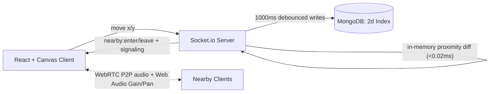
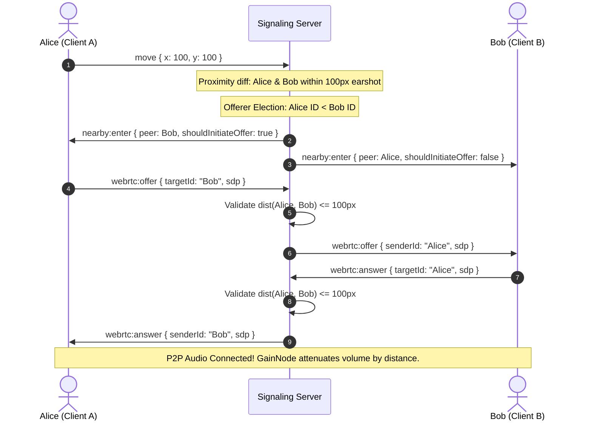

# ProxiSpeak

A 2D virtual office where voice chat depends on distance. Move your avatar around a shared office map and connect via WebRTC audio only with people within earshot (100 px).

Built as a 4-person internship project at Infotact Solutions (Group 10).

---

## 🚀 Quick Start (One-Click Launchers)

If you are on Windows, you can start the entire project with a single double-click:

| File | Description |
|---|---|
| [`start.bat`](file:///start.bat) | **Standard Launcher** — Verifies Node.js, installs dependencies if missing, and launches both the Backend Server (port 5000) and Frontend Client (`http://localhost:5173`) in parallel. |
| [`start-multi.bat`](file:///start-multi.bat) | **Multi-Instance Launcher** — Launches 2 separate Node instances (port 5000 and 5001) + Frontend Client to demonstrate Week 3 horizontal scaling. |

### Manual Installation & Running

Prerequisites: Node.js (LTS), a modern browser (Chrome / Edge / Firefox) with microphone permissions enabled.

```bash
# Clone the repository
git clone https://github.com/ABHAY-AVA2005/ProxiSpeak-project-Group-10--INFOTACT-.git
cd ProxiSpeak-project-Group-10--INFOTACT-

# Configure environment variables
cp .env.example .env

# Start Backend Server (Terminal 1)
cd server
npm install
npm run dev

# Start Frontend Client (Terminal 2)
cd ../client
npm install
npm run dev
```

Visit **`http://localhost:5173`** in two browser windows or on separate laptops on the same network. Enter usernames and walk within 100 pixels to talk!

---

## ☁️ Deploying to Vercel and Railway

The Vite client can be hosted on Vercel. The Express + Socket.IO server must run
as a persistent service, so deploy it separately to Railway.

1. In Railway, create a service from this GitHub repository and set its **Root
   Directory** to `/server`. The included `server/railway.json` starts the
   server and configures its `/health` health check. Set `REDIS_ENABLED=false`
   for a single Railway instance; MongoDB is optional and can be configured
   with `MONGODB_URI`.
2. Generate a public domain for the Railway service. Copy its HTTPS origin
   (for example, `https://your-service.up.railway.app`) and set the service's
   `CLIENT_URL` to the Vercel site origin once that is available.
3. In Vercel, import the same GitHub repository and set **Root Directory** to
   `client`. Vercel uses the client package's `npm run build` script and
   `dist` output. Set the `VITE_SERVER_URL` environment variable to the
   Railway HTTPS origin, then deploy or redeploy.
4. Open the Vercel URL and allow microphone access to test voice features.

Vercel and Railway must both be configured with the other's public origin for
the app's Socket.IO connections and cross-origin requests to work.

---

## 📊 Project Completion Status (Final Release v1.0)

**Release Tag:** `v1.0` | **Passing Automated Tests:** 66/66 (100%)  
Comprehensive review documentation: [`docs/mid-review.md`](file:///docs/mid-review.md)

| Area | Status | Verified Deliverable |
|---|---|---|
| Socket.IO Signaling Server | ✅ Implemented | Connect, disconnect, join, users:list, move, user:moved |
| Server-Side Proximity Diffing | ✅ Implemented | Dynamic earshot boundary detection (`nearby:enter` / `nearby:leave`) |
| Glare-Free WebRTC Offerer Election | ✅ Implemented | Lower socket ID rule (`shouldInitiateOffer = socketA.id < socketB.id`) |
| Proximity-Gated Signaling Relay | ✅ Implemented | Server validates distance before forwarding offer, answer, ICE |
| RAM In-Memory Spatial Engine | ✅ Implemented | $O(1)$ coordinate lookups (< 0.02 ms p95), 60 FPS gameplay |
| Coordinate Validation & Clamping | ✅ Implemented | Bounds checking ($0 \le x, y \le 2000$), XSS sanitization |
| Debounced MongoDB Persistence | ✅ Implemented | 1,000 ms debounce, race-safe disconnect cleanup (>95% I/O reduction) |
| React + HTML5 Canvas World | ✅ Implemented | Modern SaaS top-down floor layout with glass rooms, doorways, 60 FPS |
| Movement & Pathfinding | ✅ Implemented | A* click-to-walk, obstacle avoidance, directional animations, destination pin |
| P2P WebRTC Audio | ✅ Implemented | `getUserMedia` mic streaming, peer-to-peer audio mesh |
| Dynamic Distance Attenuation | ✅ Implemented | Web Audio `GainNode` volume drop-off ($100\%$ at 0 px $\to 0\%$ at max earshot) |
| Stereo Panning | ✅ Implemented | `StereoPannerNode` directional audio (left/right ear) |
| Multi-Instance Clustering & Redis | ✅ Implemented | Dual-server execution & verification with Redis Pub/Sub adapter |
| UI Controls & Teammate Directory | ✅ Implemented | Floating voice bar (mic, speaker, proximity selector, end-call), Nearby Voices widget |
| Room Layout Persistence | ✅ Implemented | Room schemas, obstacles, and REST API (`/api/rooms`) |

---

## 🛠️ System Architecture



### Signaling Sequence



---

## 🧪 Testing & Benchmarks

Run automated tests from the `/server` directory:

```bash
# Run all 66 unit & integration tests
npm test

# Run multi-instance verification test (dual Node instances)
npm run test:multi-instance

# Run multi-client movement simulation
npm run test:clients

# Run spatial engine latency audit (10 to 200 concurrent users)
npm run audit:spatial
```

### Spatial Benchmark Latency (< 20 ms Target)
| Concurrent Users | Proximity Avg (ms) | Proximity p95 (ms) | Clustering Avg (ms) | Clustering p95 (ms) | Target Met? |
|:---:|:---:|:---:|:---:|:---:|:---:|
| **25** | 0.0063 | 0.0089 | 0.0106 | 0.0120 | ✅ Yes (<20ms) |
| **50** | 0.0065 | 0.0091 | 0.0434 | 0.0696 | ✅ Yes (<20ms) |
| **100** | 0.0106 | 0.0186 | 0.2378 | 0.3553 | ✅ Yes (<20ms) |
| **200** | 0.0207 | 0.0317 | 0.9817 | 1.3458 | ✅ Yes (<20ms) |

---

## 👥 Team & Responsibilities

| Member | Role | Primary Responsibilities |
|---|---|---|
| **Abhay Varshit Aripirala** | Team Lead & Backend Lead | Socket.IO signaling server, WebRTC relay, proximity diffing, glare prevention, multi-instance clustering, merge integration. |
| **Tanvi Dighe** | Frontend Lead | React & HTML5 Canvas world, avatar movement, wall collision detection, 60 FPS loop. |
| **Abhishek Bhalla** | Frontend Audio Lead | WebRTC `getUserMedia`, `RTCPeerConnection`, Web Audio API `GainNode` and `StereoPannerNode`. |
| **Kajal Kumari Singh** | Backend & Database Lead | MongoDB schemas, `2d` spatial indexing, debounced persistence, spatial benchmarks (`audit:spatial`), Redis Pub/Sub. |

---

## 📄 Key Project Documentation
- **Mid-Review Document:** [`docs/mid-review.md`](file:///docs/mid-review.md) *(Weekly work done, architecture diagrams, and comprehensive viva Q&A)*
- **Team Plan & Roles:** [`docs/context/02_TEAM_PLAN.md`](file:///docs/context/02_TEAM_PLAN.md)
- **Mid-Review Checklist:** [`docs/mid-review-checklist.md`](file:///docs/mid-review-checklist.md)
- **Spatial Benchmark Methodology:** [`docs/benchmarks.md`](file:///docs/benchmarks.md)
- **Database Schema Reference:** [`docs/database-schema.md`](file:///docs/database-schema.md)
