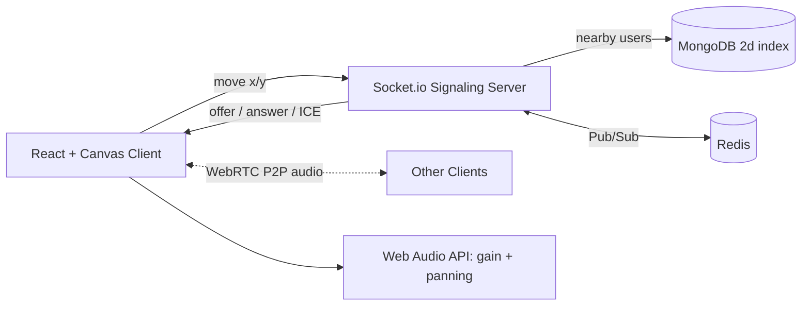

<div align="center">

---

## 📖 About

Remote tools like Zoom put everyone into rigid "rooms" where only one person can speak at a time. They miss the spontaneity of a real office, where you overhear nearby chats and walk over to join one.

**ProxiSpeak** is a 2D virtual office. You move your avatar around a map, and the audio of people nearby gets louder as you approach and quieter as you leave. It supports 50+ users in the same space.

## ✨ Features

|      | Feature                         | Description                                                                        |
| ---- | ------------------------------- | ---------------------------------------------------------------------------------- |
| 🗺️ | **2D Virtual World**      | Overhead office map drawn with React and HTML5 Canvas, with smooth avatar movement |
| 📍   | **Geospatial Engine**     | MongoDB `$near` and `$geoWithin` queries find who is within earshot (100 px)   |
| 📡   | **Signaling Server**      | Node.js and Socket.io set up WebRTC handshakes only between nearby users           |
| 🔊   | **Spatial Audio Mixer**   | Web Audio API adjusts volume (gain) and left/right panning from avatar distance    |
| 🧱   | **Obstacles Block Sound** | Furniture and walls saved in MongoDB reduce audio between avatars                  |
| 🚀   | **Scales Out**            | Redis Pub/Sub lets several Node instances share one virtual space                  |

## 🏗️ Architecture



**How it works**

1. Your client sends its x/y position about 15 times per second.
2. The server finds users within 100 px and tells both sides to connect.
3. The lower socket id sends the WebRTC offer, and audio flows peer to peer.
4. Each client mixes incoming audio by distance, with volume and stereo pan.

## 🎯 Performance Targets

| Metric                         | Target                  |
| ------------------------------ | ----------------------- |
| Proximity query and clustering | under **20 ms**   |
| Concurrent users               | **50+**           |
| Canvas rendering               | steady **60 FPS** |
| Earshot radius                 | **100 px**        |

Measured results are in [`docs/benchmarks.md`](docs/benchmarks.md) *(added during the mid review)*.

## 🧰 Tech Stack

| Layer      | Technology                                                    |
| ---------- | ------------------------------------------------------------- |
| Frontend   | React, HTML5 Canvas, Web Audio API, WebRTC (`getUserMedia`) |
| Backend    | Node.js, Express, Socket.io                                   |
| Database   | MongoDB (`2d` geospatial index)                             |
| Scaling    | Redis Pub/Sub, `@socket.io/redis-adapter`                   |
| Deployment | HTTPS hosting (frontend and backend), MongoDB Atlas           |

## 📁 Project Structure

```
ProxiSpeak/
├── client/              React app (components, hooks, world, audio)
├── server/              Express + Socket.io (sockets, models, routes, services)
├── docs/
│   ├── context/         Project brief, plan, rules, decisions, progress log
│   └── benchmarks.md    Spatial audit and load test results
├── .env.example         Required environment variables (no secrets)
└── README.md
```

## 🔌 Socket.IO Events

The real-time layer is managed by Node.js and Socket.IO in `server/server.js`. Below are the verified Socket.IO events currently implemented in the backend, along with their direction, payload structure, and server-side handling logic:

### Implemented Events Summary

| Event Name | Direction | Payload Type | Trigger / Description |
|---|---|---|---|
| `connection` | Client → Server | Standard handshake | Established when a client connects to the server |
| `current-players` | Server → Client | `Object` (Player Map) | Sent exclusively to the connecting client with all active players |
| `player-joined` | Server → Client | `Object` (Player) | Broadcast to all other clients when a newcomer joins |
| `player-move` | Client → Server | `Object` (`{ x, y }`) | Emitted by client on avatar movement (validated & debounced) |
| `player-moved` | Server → Client | `Object` (`{ id, x, y }`) | Broadcast immediately to all other clients upon valid movement |
| `disconnect` | Client → Server | Lifecycle event | Triggered when a socket connection terminates |
| `player-disconnected` | Server → Client | `string` (`id`) | Broadcast to remaining clients to remove the departed avatar |

---

### Detailed Event Specifications

#### 1. `connection` (Lifecycle)
- **Direction:** Client → Server
- **When it occurs:** When a client opens a Socket.IO connection to `http://localhost:5000`.
- **Server Behavior:**
  - Assigns initial spawn state in memory: `players[socket.id] = { id: socket.id, x: 400, y: 400 }`.
  - Emits `current-players` to the joining socket.
  - Broadcasts `player-joined` to all other connected sockets.
  - Triggers asynchronous MongoDB upsert via `Player.findOneAndUpdate({ playerId: socket.id }, ...)`.
  - Tracks the database operation in `inFlightWrites` to prevent race conditions during early disconnection.

#### 2. `current-players`
- **Direction:** Server → Client (Unicast to connecting client)
- **Payload Structure:**
  ```json
  {
    "<socketId>": {
      "id": "8UiVQwcLOvzoPaQBAAAA",
      "x": 400,
      "y": 400
    }
  }
  ```
- **When it occurs:** Immediately upon successful socket connection.
- **Server Behavior:** Delivers the complete snapshot of active players from in-memory state so the new client can render existing avatars.

#### 3. `player-joined`
- **Direction:** Server → Client (Broadcast to all other clients: `socket.broadcast.emit`)
- **Payload Structure:**
  ```json
  {
    "id": "8UiVQwcLOvzoPaQBAAAA",
    "x": 400,
    "y": 400
  }
  ```
- **When it occurs:** Immediately after a new player's initial memory record is registered.
- **Server Behavior:** Informs all other connected clients of the newcomer so their canvases render the new avatar.

#### 4. `player-move`
- **Direction:** Client → Server
- **Payload Structure:**
  ```json
  {
    "x": 425,
    "y": 380
  }
  ```
  - `x`: `number` — Canvas horizontal coordinate
  - `y`: `number` — Canvas vertical coordinate
- **When it occurs:** Emitted by the client when the user moves the avatar.
- **Server Behavior:**
  - **Validation:** Verifies the socket is registered and not marked disconnected. Validates coordinates via `isValidCoordinate(x, y)` (`0 <= x <= 1000`, `0 <= y <= 600`, finite numbers). Invalid inputs are discarded with no state mutation or broadcast.
  - **In-Memory Update:** Updates `players[socket.id].x` and `players[socket.id].y` immediately (in-memory state is the single source of truth for real-time rendering).
  - **Real-Time Broadcast:** Immediately broadcasts `player-moved` to all other clients (zero database lag for 60 FPS motion).
  - **Debounced Persistence:** Resets a 1000ms debounce timer (`DB_DEBOUNCE_MS`). Writes to MongoDB via `Player.updateOne` only after 1 second of stillness, minimizing database write load.

#### 5. `player-moved`
- **Direction:** Server → Client (Broadcast to all other clients: `socket.broadcast.emit`)
- **Payload Structure:**
  ```json
  {
    "id": "8UiVQwcLOvzoPaQBAAAA",
    "x": 425,
    "y": 380
  }
  ```
- **When it occurs:** Immediately upon receiving a valid `player-move` event.
- **Server Behavior:** Propagates the new coordinates to all other clients in real time for smooth remote interpolation.

#### 6. `disconnect` & `player-disconnected`
- **Direction:**
  - `disconnect`: Client → Server (Socket.IO standard event)
  - `player-disconnected`: Server → Client (Broadcast to all other clients)
- **`player-disconnected` Payload Structure:**
  - Primitive `string` containing the disconnected socket ID (e.g., `"8UiVQwcLOvzoPaQBAAAA"`).
- **When it occurs:** When a client closes the tab, navigates away, or drops connection.
- **Server Behavior:**
  - Registers the socket in `disconnectedSockets` tombstone set to prevent delayed asynchronous operations from recreating the record.
  - Clears any pending movement debounce timer.
  - Removes the player from in-memory `players` map.
  - Broadcasts `player-disconnected` with the socket ID to remaining clients.
  - Awaits any in-flight database write for this player (`inFlightWrites`).
  - Persists the final position if a movement write was pending.
  - Removes the player record from MongoDB via `Player.deleteOne({ playerId: socket.id })`.
  - Clears the tombstone after an unreferenced 5-second buffer timer.

> **Note on Roadmap Events:** WebRTC signaling events (`webrtc:offer`, `webrtc:answer`, `webrtc:ice`) and proximity boundary events (`nearby:enter`, `nearby:leave`) mentioned in architectural specifications are scheduled for Week 2 (Proximity and WebRTC Audio) and are not yet implemented in `server/server.js`.

---

## 🗄️ Database Schema & Persistence

The database layer is managed with Mongoose in `server/models/Player.js` and coordinates with `server/server.js`.

### Mongoose Player Schema

```javascript
const playerSchema = new mongoose.Schema(
    {
        playerId: {
            type: String,
            required: true,
            unique: true,
            index: true,
        },
        x: {
            type: Number,
            required: true,
            default: 400,
        },
        y: {
            type: Number,
            required: true,
            default: 400,
        },
        position: {
            type: [Number], // [x, y] in canvas pixels
            required: true,
            default: [400, 400],
        },
        lastSeen: {
            type: Date,
            default: Date.now,
        },
    },
    {
        timestamps: true, // adds createdAt and updatedAt
    }
);

// 2D geospatial index for flat Cartesian coordinates
playerSchema.index({ position: "2d" });
```

### Schema Fields & Types

| Field | Type | Required | Default | Description |
|---|---|---|---|---|
| `playerId` | `String` | Yes | — | Unique Socket.IO socket identifier (`socket.id`), indexed for fast lookup |
| `x` | `Number` | Yes | `400` | Current horizontal coordinate on the 1000x600 canvas |
| `y` | `Number` | Yes | `400` | Current vertical coordinate on the 1000x600 canvas |
| `position` | `[Number]` | Yes | `[400, 400]` | 2D coordinate array `[x, y]` in canvas pixels |
| `lastSeen` | `Date` | No | `Date.now` | Timestamp of the most recent connect or position write |
| `createdAt` | `Date` | Auto | Generated | Document creation timestamp (managed by `timestamps: true`) |
| `updatedAt` | `Date` | Auto | Generated | Document last update timestamp (managed by `timestamps: true`) |

### Geospatial `2d` Index
- **Index Definition:** `{ position: "2d" }`
- **Index Type:** MongoDB legacy `2d` index on flat Cartesian coordinate pairs `[x, y]`.
- **Purpose & Rationale:** The virtual office is a flat `1000 x 600` pixel canvas. Unlike spherical `2dsphere` indexes designed for Earth latitude/longitude coordinates, the `2d` index computes planar Euclidean distances directly in pixel units.
- **Intended Proximity Queries:** Designed to power planned `$near` and `$geoWithin` queries (e.g. `Player.find({ position: { $near: [x, y], $maxDistance: 100 } })` for finding peers within the 100-pixel earshot radius).
- *Implementation Note:* Proximity filtering logic is planned for Week 2; current movement updates broadcast to all connected clients while utilizing the `2d` index for coordinate storage.

### Coordinate Validation Rules
Validation is defined in `server/utils/validation.js` and enforced before any state updates:
- **Canvas Boundaries:** Defined by `CANVAS_BOUNDS = { MIN_X: 0, MAX_X: 1000, MIN_Y: 0, MAX_Y: 600 }`.
- **Type Safety:** Coordinates must be finite JavaScript numbers (`typeof === 'number'`, `Number.isFinite()`).
- **Range Constraints:** Rejects negative coordinates (`x < 0`, `y < 0`) and out-of-bounds coordinates (`x > 1000`, `y > 600`).
- **Defensive Dropping:** Non-numbers, `NaN`, `Infinity`, strings, `null`, and undefined values are dropped silently without mutating in-memory players or scheduling database operations.

### Lifecycle & Persistence Mechanics

1. **Player Creation & Upsert on Join:**
   - Handled via `Player.findOneAndUpdate({ playerId: socket.id }, { ... }, { upsert: true, returnDocument: "after", setDefaultsOnInsert: true })`.
   - Initialized with default spawn point `[400, 400]`.
   - Tracked in `inFlightWrites` to prevent race conditions during early disconnection.
2. **Debounced Movement Persistence:**
   - Avatars can generate 15–60 move events per second. Writing every event to disk would bottleneck the database.
   - Updates are held in memory, and writes are debounced with `DB_DEBOUNCE_MS = 1000` (1 second).
   - Only after movement ceases for 1 second is `Player.updateOne` called with final coordinates `[latestX, latestY]`.
   - Reduces database writes by over 95% while maintaining instantaneous client-side broadcasts.
3. **Safe Disconnect Cleanup:**
   - Cancels any active debounce timer to prevent dangling timeouts.
   - Immediately registers the socket in `disconnectedSockets` so late async writes cannot resurrect deleted documents.
   - Flushes the final pending position to the database if an unsaved movement existed.
   - Awaits any in-flight database write for this socket to ensure sequential execution.
   - Deletes the document via `Player.deleteOne({ playerId: socket.id })`.
   - Unrefs a 5-second cleanup timer to prune the tombstone set without keeping the Node.js event loop alive.

## 🚀 Getting Started

> Setup steps will be finalised as the project grows. Update this section each week.

**Prerequisites:** Node.js (LTS), Git, a MongoDB Atlas account, a microphone and headphones.

```bash
# 1. Clone
git clone https://github.com/ABHAY-AVA2005/ProxiSpeak-project-Group-10--INFOTACT-.git
cd ProxiSpeak-project-Group-10--INFOTACT-

# 2. Environment
cp .env.example .env        # fill in your own values, never commit .env

# 3. Backend
cd server && npm install && npm run dev

# 4. Frontend (new terminal)
cd client && npm install && npm run dev
```

Open the app in **two browser tabs or two devices**, join with different names, and walk the avatars close together to hear each other. Use headphones to avoid echo.

## 🗓️ Roadmap

| Week                   | Backend                                                           | Frontend                                    | Status |
| ---------------------- | ----------------------------------------------------------------- | ------------------------------------------- | ------ |
| **1**            | Socket.io server, avatar x/y broadcast, MongoDB geospatial schema | React Canvas world, keyboard/mouse movement | ⬜     |
| **2**            | `$near` proximity groups, signaling only within 100 px          | WebRTC P2P audio with `getUserMedia`      | ⬜     |
| **Mid Review**   | Spatial audit under 20 ms                                         | Two-browser audio demo                      | ⬜     |
| **3**            | Redis Pub/Sub, mesh scaling                                       | Web Audio volume drop-off by distance       | ⬜     |
| **4**            | Room and obstacle persistence                                     | Stereo panning, steady 60 FPS               | ⬜     |
| **Final Review** | Scalable stateful geospatial server                               | Immersive physics-aware audio platform      | ⬜     |

*(Change ⬜ to ✅ as each stage is merged into `main`.)*

## 👥 Team

| Member                            | Role                            | Branch              |
| --------------------------------- | ------------------------------- | ------------------- |
| **Abhay Varshit Aripirala** | Team Lead, Backend (signaling)  | `abhay-team-lead` |
| **Tanvi Dighe**             | Frontend (Canvas world)         | `tanvi-frontend`  |
| **Abhishek Bhalla**         | Frontend (WebRTC and Web Audio) | `abhishek-audio`  |
| **Kajal Kumari Singh**      | Backend (MongoDB, Redis)        | `kajal-backend`   |

## 🔀 Git Workflow

- `main` holds only reviewed, merged code. The team lead merges.
- Everyone commits **daily** in their own branch.
- Commit format: `type: short meaning` (`feat`, `fix`, `docs`, `test`, `chore`, `perf`, `refactor`).
- Never commit secrets. Use `.env`.

##### **PULL REQ ->MERGE FLOW**

To ensure a pull request (PR) is correct before merging, you should review and test it using the following steps:

* **Read the Title and Description:**
* Understand the context, problem being solved, or feature being added.
* Check if the author linked any relevant issues or task tickets.
* **Review the Code Changes ("Files Changed" tab):**
* **Functionality:** Check if the logic solves the intended problem without creating edge-case bugs.
* **Code Quality & Readability:** Ensure naming conventions, code structure, and formatting follow project standards.
* **Security & Performance:** Look for security risks (e.g., exposed credentials, unvalidated inputs) or inefficient queries/loops.
* **Scope:** Make sure the PR only changes what it intends to change, without unrelated modifications.
* **Check Automated Tests and CI Status:**
* Verify if all continuous integration (CI) checks (like GitHub Actions) pass.
* Ensure unit, integration, or end-to-end tests are passing.
* Check test coverage to ensure new code includes corresponding tests.
* **Test the Changes Locally:**
* Fetch and switch to the PR branch using the Git CLI or GitHub CLI (`gh pr checkout <pr-number>`).
* Run the project locally and verify the UI or API functionality works as expected.
* Run tests locally to verify no regressions occur.
* **Use Code Review Features:**
* Leave inline comments or questions on specific lines of code if anything is unclear.
* Select **Request Changes** if fixes are needed before merging.
* Select **Approve** once all criteria are met and the code is ready.
* **Merge the Pull Request:**
* Choose the appropriate merge strategy (Create a merge commit, Squash and merge, or Rebase and merge).
* Click **Confirm merge** and delete the feature branch if it is no longer needed.

## 📄 Documentation

Detailed documents live in [`docs/context/`](docs/context/): project brief, team plan, evaluation, GitHub rules and technical decisions.

## 🔒 Note

This is an internship project built for **Infotact Solutions**. Confidential information from the internship is not to be shared outside the team.

<div align="center">
