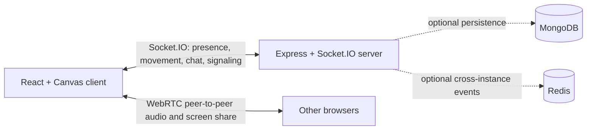

# ProxiSpeak

**A browser-based virtual office for spatial conversations and remote teamwork.**
Move through a shared 2D office, talk with nearby teammates, chat with a room or
the whole meeting, send direct messages, and share your screen.

## Live app

**https://proxi-speak-project-group-10-infota.vercel.app/**

| Service | URL | Purpose |
|---|---|---|
| Web app | https://proxi-speak-project-group-10-infota.vercel.app/ | React + Vite frontend hosted on Vercel |
| Socket server health | [Render health check](https://proxispeak-server-hkvz.onrender.com/health) | Express and Socket.IO backend hosted on Render |
| Server health | [/health](https://proxispeak-server-hkvz.onrender.com/health) | Backend health and optional-service status |

The live app and backend health endpoint were checked on **12 November 2026**.
The backend reports healthy and Redis connected. MongoDB is not connected;
database persistence is optional, so chat and presence continue to use
in-memory state where applicable.

## Technology stack

| Technology | Where it is used |
|---|---|
| React 19 | Builds the interactive office, chat, team directory, and call controls as reusable UI components. |
| JavaScript (ES modules), HTML, and CSS | Client and server application code, page structure, and responsive styling. |
| Canvas and A* pathfinding | Draws the 2D office and finds routes around furniture and walls when users click to move. |
| Vite | Runs the client development server and bundles the frontend for production. |
| Node.js | Runtime for the JavaScript backend. |
| Express | Provides backend HTTP endpoints, including `/health` and the room list API. |
| Socket.IO | Maintains realtime connections for presence, movement, chat, and WebRTC signaling. |
| WebRTC | Connects browsers peer-to-peer for proximity voice and screen sharing; Socket.IO relays signaling, not media. |
| Redis (Upstash) with `ioredis` and `@socket.io/redis-adapter` | Shares presence, proximity signaling, and Socket.IO broadcasts across backend instances. Production health currently reports Redis connected. |
| MongoDB with Mongoose (optional) | Provides database persistence when configured. It is not connected in the current production health check. |
| Vercel | Hosts the built static React/Vite frontend. |
| Render | Hosts the persistent Node.js/Express/Socket.IO backend. |

## Features

- **Virtual office:** a 2D office map with Meeting Room, Focus Zone, Open
  Workspace, Lounge, and Pantry.
- **Movement and pathfinding:** keyboard movement plus click-to-move navigation
  using the A* pathfinding algorithm to route around office furniture and walls.
- **Proximity voice:** WebRTC audio connections with adjustable listening
  distance, volume attenuation, and stereo positioning.
- **Room chat and All chat:** two audience modes in the chat panel. Room chat
  follows the room selected when joining; All chat is for everyone in the
  meeting.
- **Direct messages:** start a private conversation from the Team directory.
- **Screen sharing:** share a screen with meeting participants.
- **Meetings:** create a shared room schedule, choose a time and duration, add
  invitee emails, and remove meetings you created. MongoDB makes schedules
  durable; without MongoDB, the server uses temporary in-memory storage.
- **Meeting invitations:** email delivery uses Resend when `RESEND_API_KEY` and
  `EMAIL_FROM` are configured privately in Render. The UI reports when delivery
  is not configured or fails.
- **In-call controls:** per-person volume, microphone and speaker controls,
  push-to-talk, camera/screen share, raised hands, and reactions.
- **Office updates:** send room-wide floor announcements, review recent
  sessions saved in this browser, and rejoin a previously used room.
- **Map controls:** zoom, grid, fullscreen, live coordinates, click-to-move,
  and keyboard navigation.
- **Live directory:** see who is online and open a teammate's direct chat.
- **Office-room selection:** choose a listed office room when joining.

Chat history is held in server memory, not a durable database. Room and meeting
history is cleared when the last participant leaves its scope; direct-message
history is cleared when either participant disconnects. A server restart also
clears in-memory chat. Scheduled meetings use MongoDB when connected and
otherwise fall back to server memory, which is not durable across restarts.
Recent session history and individual volume preferences are local to the
browser. Although Redis is connected in production, direct-message recipient
lookup and chat history are still process-local; they are not shared between
backend instances.

## Run locally

**Requirements:** a recent Node.js LTS release and a modern browser. Microphone
access is required for voice chat; allow it when prompted.

### Windows quick start

Run [`start.bat`](./start.bat) to start the backend and frontend. The client
opens at `http://localhost:5173`; the server uses port `5000`.

### Manual start

In PowerShell, from the repository root:

```powershell
Copy-Item .env.example server\.env
Set-Location server
npm install
npm run dev
```

In a second terminal:

```powershell
Set-Location client
npm install
npm run dev
```

Open `http://localhost:5173`. To try the live office with other people, use
separate browser profiles or devices and join the same room.

## Deployment

The frontend and realtime backend are separate services:

- **Vercel** builds the `client` directory and serves the static Vite app.
- **Render** runs the persistent Express + Socket.IO server from `server`.

The live URLs, required environment variables, health checks, and redeployment
steps are documented in [Deployment guide](./docs/DEPLOYMENT.md). Keep
environment secrets in the hosting provider's environment settings, not in
Git.

## Development and tests

Build and lint the frontend:

```powershell
Set-Location client
npm run build
npm run lint
```

Run backend tests:

```powershell
Set-Location server
npm test
```

Other useful backend checks:

```powershell
npm run test:multi-instance
npm run test:clients
npm run audit:spatial
```

The multi-instance checks require a reachable Redis service and
`REDIS_ENABLED=true`. See the [deployment guide](./docs/DEPLOYMENT.md) to
configure Upstash and verify Redis in production.

## Architecture



The server validates signaling and coordinates presence. Audio and screen-share
media are negotiated between browsers using WebRTC. MongoDB persistence and
Redis cross-instance coordination are optional; check `/health` to see whether
they are connected in a particular deployment.

## Project documentation

- [Deployment guide](./docs/DEPLOYMENT.md) — hosting layout, configuration,
  health checks, and troubleshooting.
- [Progress log](./docs/context/06_PROGRESS_LOG.md) — dated project status and
  historical milestones.
- [Project brief](./docs/context/01_PROJECT_BRIEF.md) — original goals and
  requirements.
- [Database schema](./docs/database-schema.md) — persistence model and indexes.
- [Redis scaling](./docs/REDIS_SCALING.md) — optional multi-instance design.
- [Mid-review checklist](./docs/mid-review-checklist.md) — review materials.
