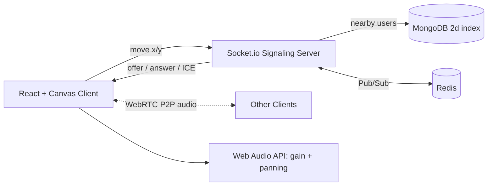

<div align="center">

---

## 📖 About

Remote tools like Zoom put everyone into rigid "rooms" where only one person can speak at a time. They miss the spontaneity of a real office, where you overhear nearby chats and walk over to join one.

**ProxiSpeak** is a 2D virtual office. You move your avatar around a map, and the audio of people nearby gets louder as you approach and quieter as you leave. It supports 50+ users in the same space.

## ✨ Features

|      | Feature                         | Description                                                                        |
| ---- | ------------------------------- | ---------------------------------------------------------------------------------- |
| 🗺️ | **2D Virtual World**      | Overhead office map drawn with React and HTML5 Canvas, with smooth avatar movement |
| 📍   | **Geospatial Engine**     | MongoDB `$near` and `$geoWithin` queries find who is within earshot (100 px)   |
| 📡   | **Signaling Server**      | Node.js and Socket.io set up WebRTC handshakes only between nearby users           |
| 🔊   | **Spatial Audio Mixer**   | Web Audio API adjusts volume (gain) and left/right panning from avatar distance    |
| 🧱   | **Obstacles Block Sound** | Furniture and walls saved in MongoDB reduce audio between avatars                  |
| 🚀   | **Scales Out**            | Redis Pub/Sub lets several Node instances share one virtual space                  |

## 🏗️ Architecture



**How it works**

1. Your client sends its x/y position about 15 times per second.
2. The server finds users within 100 px and tells both sides to connect.
3. The lower socket id sends the WebRTC offer, and audio flows peer to peer.
4. Each client mixes incoming audio by distance, with volume and stereo pan.

## 🎯 Performance Targets

| Metric                         | Target                  |
| ------------------------------ | ----------------------- |
| Proximity query and clustering | under **20 ms**   |
| Concurrent users               | **50+**           |
| Canvas rendering               | steady **60 FPS** |
| Earshot radius                 | **100 px**        |

Measured results are in [`docs/benchmarks.md`](docs/benchmarks.md) *(added during the mid review)*.

## 🧰 Tech Stack

| Layer      | Technology                                                    |
| ---------- | ------------------------------------------------------------- |
| Frontend   | React, HTML5 Canvas, Web Audio API, WebRTC (`getUserMedia`) |
| Backend    | Node.js, Express, Socket.io                                   |
| Database   | MongoDB (`2d` geospatial index)                             |
| Scaling    | Redis Pub/Sub, `@socket.io/redis-adapter`                   |
| Deployment | HTTPS hosting (frontend and backend), MongoDB Atlas           |

## 📁 Project Structure

```
ProxiSpeak/
├── client/              React app (components, hooks, world, audio)
├── server/              Express + Socket.io (sockets, models, routes, services)
├── docs/
│   ├── context/         Project brief, plan, rules, decisions, progress log
│   └── benchmarks.md    Spatial audit and load test results
├── .env.example         Required environment variables (no secrets)
└── README.md
```

## 🔌 Socket.IO Events Reference
 
| Event Name | Direction | Payload | Description |
|---|---|---|---|
| `join` | Client ➔ Server | `{ username: string, x?: number, y?: number }` | Register user into spatial session and persist join |
| `users:list` | Server ➔ Client | `Array<User>` | Initial snapshot of all active players in the world |
| `user:joined` | Server ➔ Client (broadcast) | `{ socketId, username, x, y }` | Notifies active clients when a new user enters |
| `move` | Client ➔ Server | `{ x: number, y: number }` | Sends client's updated coordinate position |
| `user:moved` | Server ➔ Client (broadcast) | `{ socketId, x, y }` | Zero-lag WebSocket broadcast to all peers |
| `user:left` | Server ➔ Client (broadcast) | `{ socketId }` | Clean disconnect cleanup and DB persistence flush |
| `nearby:enter` | Server ➔ Client | `{ socketId, id, username, x, y, shouldInitiateOffer: boolean }` | Notifies when a peer enters 100px earshot (includes glare-free offer election) |
| `nearby:leave` | Server ➔ Client | `{ socketId, id }` | Notifies when a peer leaves 100px earshot to close peer connection |
| `webrtc:offer` | Client ⇄ Server (Relay) | `{ targetId, offer }` / `{ senderId, offer }` | Relays WebRTC SDP offer strictly within 100px proximity radius |
| `webrtc:answer` | Client ⇄ Server (Relay) | `{ targetId, answer }` / `{ senderId, answer }` | Relays WebRTC SDP answer strictly within 100px proximity radius |
| `webrtc:ice-candidate` | Client ⇄ Server (Relay) | `{ targetId, candidate }` / `{ senderId, candidate }` | Relays ICE candidate for P2P audio track establishment within 100px |


## 🧪 Testing & Simulation Scripts

From the `server/` directory:
- `npm test`: Runs Node.js automated test suite (`persistence.test.js` validating Cartesian `2d` index, clamping, and debouncing).
- `npm run test:clients`: Runs `fake-clients.js` multi-avatar simulation with customizable duration and client count.
- `npm run migrate:indexes`: Audits and ensures the `position_2d` index in MongoDB.

## 🚀 Getting Started

> Setup steps will be finalised as the project grows. Update this section each week.

**Prerequisites:** Node.js (LTS), Git, a MongoDB Atlas account, a microphone and headphones.

```bash
# 1. Clone
git clone https://github.com/ABHAY-AVA2005/ProxiSpeak-project-Group-10--INFOTACT-.git
cd ProxiSpeak-project-Group-10--INFOTACT-

# 2. Environment
cp .env.example .env        # fill in your own values, never commit .env

# 3. Backend
cd server && npm install && npm run dev

# 4. Frontend (new terminal)
cd client && npm install && npm run dev
```

Open the app in **two browser tabs or two devices**, join with different names, and walk the avatars close together to hear each other. Use headphones to avoid echo.

## 🗓️ Roadmap

| Week                   | Backend                                                           | Frontend                                    | Status |
| ---------------------- | ----------------------------------------------------------------- | ------------------------------------------- | ------ |
| **1**            | Socket.io server, avatar x/y broadcast, MongoDB geospatial schema | React Canvas world, keyboard/mouse movement | ⬜     |
| **2**            | `$near` proximity groups, signaling only within 100 px          | WebRTC P2P audio with `getUserMedia`      | ⬜     |
| **Mid Review**   | Spatial audit under 20 ms                                         | Two-browser audio demo                      | ⬜     |
| **3**            | Redis Pub/Sub, mesh scaling                                       | Web Audio volume drop-off by distance       | ⬜     |
| **4**            | Room and obstacle persistence                                     | Stereo panning, steady 60 FPS               | ⬜     |
| **Final Review** | Scalable stateful geospatial server                               | Immersive physics-aware audio platform      | ⬜     |

*(Change ⬜ to ✅ as each stage is merged into `main`.)*

## 👥 Team

| Member                            | Role                            | Branch              |
| --------------------------------- | ------------------------------- | ------------------- |
| **Abhay Varshit Aripirala** | Team Lead, Backend (signaling)  | `abhay-team-lead` |
| **Tanvi Dighe**             | Frontend (Canvas world)         | `tanvi-frontend`  |
| **Abhishek Bhalla**         | Frontend (WebRTC and Web Audio) | `abhishek-audio`  |
| **Kajal Kumari Singh**      | Backend (MongoDB, Redis)        | `kajal-backend`   |

## 🔀 Git Workflow

- `main` holds only reviewed, merged code. The team lead merges.
- Everyone commits **daily** in their own branch.
- Commit format: `type: short meaning` (`feat`, `fix`, `docs`, `test`, `chore`, `perf`, `refactor`).
- Never commit secrets. Use `.env`.

##### **PULL REQ ->MERGE FLOW**

To ensure a pull request (PR) is correct before merging, you should review and test it using the following steps:

* **Read the Title and Description:**
* Understand the context, problem being solved, or feature being added.
* Check if the author linked any relevant issues or task tickets.
* **Review the Code Changes ("Files Changed" tab):**
* **Functionality:** Check if the logic solves the intended problem without creating edge-case bugs.
* **Code Quality & Readability:** Ensure naming conventions, code structure, and formatting follow project standards.
* **Security & Performance:** Look for security risks (e.g., exposed credentials, unvalidated inputs) or inefficient queries/loops.
* **Scope:** Make sure the PR only changes what it intends to change, without unrelated modifications.
* **Check Automated Tests and CI Status:**
* Verify if all continuous integration (CI) checks (like GitHub Actions) pass.
* Ensure unit, integration, or end-to-end tests are passing.
* Check test coverage to ensure new code includes corresponding tests.
* **Test the Changes Locally:**
* Fetch and switch to the PR branch using the Git CLI or GitHub CLI (`gh pr checkout <pr-number>`).
* Run the project locally and verify the UI or API functionality works as expected.
* Run tests locally to verify no regressions occur.
* **Use Code Review Features:**
* Leave inline comments or questions on specific lines of code if anything is unclear.
* Select **Request Changes** if fixes are needed before merging.
* Select **Approve** once all criteria are met and the code is ready.
* **Merge the Pull Request:**
* Choose the appropriate merge strategy (Create a merge commit, Squash and merge, or Rebase and merge).
* Click **Confirm merge** and delete the feature branch if it is no longer needed.

## 📄 Documentation

Detailed documents live in [`docs/context/`](docs/context/): project brief, team plan, evaluation, GitHub rules and technical decisions.

## 🔒 Note

This is an internship project built for **Infotact Solutions**. Confidential information from the internship is not to be shared outside the team.

<div align="center">
