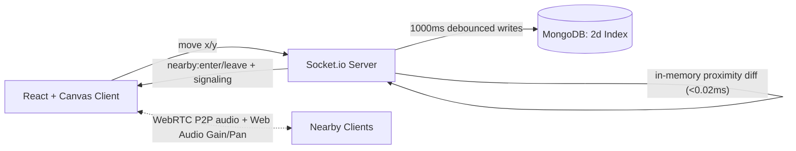
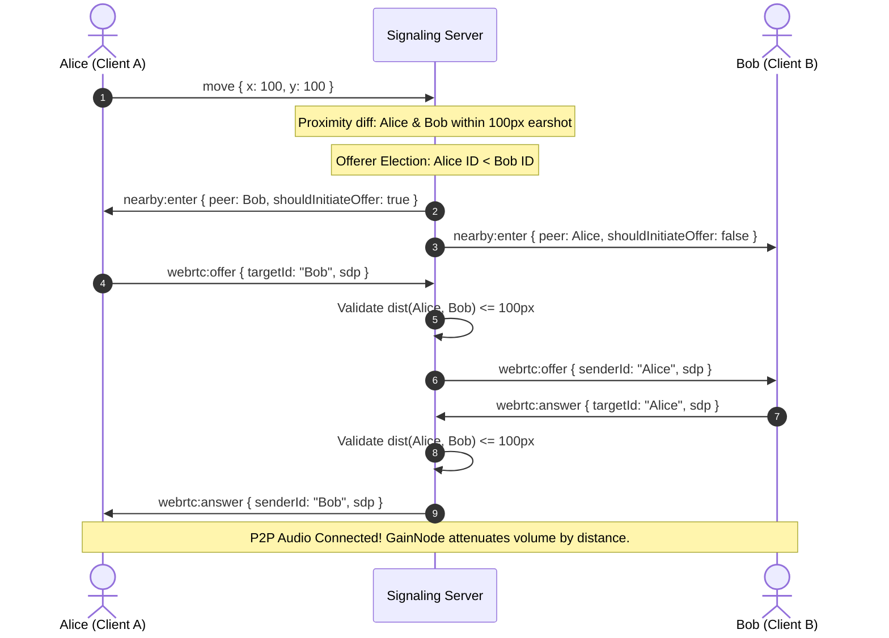

# ProxiSpeak

A 2D virtual office where voice chat depends on distance. Move your avatar around a shared office map and connect via WebRTC audio only with people within earshot (100 px).

Built as a 4-person internship project at Infotact Solutions (Group 10).

---

## 🚀 Quick Start (One-Click Launchers)

If you are on Windows, you can start the entire project with a single double-click:

| File | Description |
|---|---|
| [`start.bat`](file:///start.bat) | **Standard Launcher** — Verifies Node.js, installs dependencies if missing, and launches both the Backend Server (port 5000) and Frontend Client (`http://localhost:5173`) in parallel. |
| [`start-multi.bat`](file:///start-multi.bat) | **Multi-Instance Launcher** — Launches 2 separate Node instances (port 5000 and 5001) + Frontend Client to demonstrate Week 3 horizontal scaling. |

### Manual Installation & Running

Prerequisites: Node.js (LTS), a modern browser (Chrome / Edge / Firefox) with microphone permissions enabled.

```bash
# Clone the repository
git clone https://github.com/ABHAY-AVA2005/ProxiSpeak-project-Group-10--INFOTACT-.git
cd ProxiSpeak-project-Group-10--INFOTACT-

# Configure environment variables
cp .env.example .env

# Start Backend Server (Terminal 1)
cd server
npm install
npm run dev

# Start Frontend Client (Terminal 2)
cd ../client
npm install
npm run dev
```

Visit **`http://localhost:5173`** in two browser windows or on separate laptops on the same network. Enter usernames and walk within 100 pixels to talk!

---

## 📊 Mid-Project Review Status (Week 1 to Week 2 End)

**Release Tag:** `v0.2-mid` | **Passing Automated Tests:** 66/66 (100%)  
Comprehensive review documentation: [`docs/mid-review.md`](file:///docs/mid-review.md)

| Area | Status | Verified Deliverable |
|---|---|---|
| Socket.IO Signaling Server | ✅ Implemented | Connect, disconnect, join, users:list, move, user:moved |
| Server-Side Proximity Diffing | ✅ Implemented | 100 px boundary detection (`nearby:enter` / `nearby:leave`) |
| Glare-Free WebRTC Offerer Election | ✅ Implemented | Lower socket ID rule (`shouldInitiateOffer = socketA.id < socketB.id`) |
| Proximity-Gated Signaling Relay | ✅ Implemented | Server validates $\le 100$ px before forwarding offer, answer, ICE |
| RAM In-Memory Spatial Engine | ✅ Implemented | $O(1)$ coordinate lookups (< 0.02 ms p95), 60 FPS gameplay |
| Coordinate Validation & Clamping | ✅ Implemented | Bounds checking ($0 \le x, y \le 2000$), XSS sanitization |
| Debounced MongoDB Persistence | ✅ Implemented | 1,000 ms debounce, race-safe disconnect cleanup (>95% I/O reduction) |
| React + HTML5 Canvas World | ✅ Implemented | 60 FPS game loop, wall collisions, coordinate lerping |
| P2P WebRTC Audio | ✅ Implemented | `getUserMedia` mic streaming, peer-to-peer audio mesh |
| Dynamic Distance Attenuation | ✅ Implemented | Web Audio `GainNode` volume drop-off ($100\%$ at 0 px $\to 0\%$ at 100 px) |
| Stereo Panning | ✅ Implemented | `StereoPannerNode` directional audio (left/right ear) |
| Multi-Instance Clustering Test | ✅ Implemented | Dual-server execution & verification (`test:multi-instance`) |
| Obstacle Sound Attenuation | ⏳ Planned (Week 4) | Sound blockage through meeting room walls |
| Room Layout Persistence | ⏳ Planned (Week 4) | Custom furniture and room layouts saved to DB |

---

## 🛠️ System Architecture



### Signaling Sequence



---

## 🧪 Testing & Benchmarks

Run automated tests from the `/server` directory:

```bash
# Run all 66 unit & integration tests
npm test

# Run multi-instance verification test (dual Node instances)
npm run test:multi-instance

# Run multi-client movement simulation
npm run test:clients

# Run spatial engine latency audit (10 to 200 concurrent users)
npm run audit:spatial
```

### Spatial Benchmark Latency (< 20 ms Target)
| Concurrent Users | Proximity Avg (ms) | Proximity p95 (ms) | Clustering Avg (ms) | Clustering p95 (ms) | Target Met? |
|:---:|:---:|:---:|:---:|:---:|:---:|
| **25** | 0.0063 | 0.0089 | 0.0106 | 0.0120 | ✅ Yes (<20ms) |
| **50** | 0.0065 | 0.0091 | 0.0434 | 0.0696 | ✅ Yes (<20ms) |
| **100** | 0.0106 | 0.0186 | 0.2378 | 0.3553 | ✅ Yes (<20ms) |
| **200** | 0.0207 | 0.0317 | 0.9817 | 1.3458 | ✅ Yes (<20ms) |

---

## 👥 Team & Responsibilities

| Member | Role | Primary Responsibilities |
|---|---|---|
| **Abhay Varshit Aripirala** | Team Lead & Backend Lead | Socket.IO signaling server, WebRTC relay, proximity diffing, glare prevention, multi-instance clustering, merge integration. |
| **Tanvi Dighe** | Frontend Lead | React & HTML5 Canvas world, avatar movement, wall collision detection, 60 FPS loop. |
| **Abhishek Bhalla** | Frontend Audio Lead | WebRTC `getUserMedia`, `RTCPeerConnection`, Web Audio API `GainNode` and `StereoPannerNode`. |
| **Kajal Kumari Singh** | Backend & Database Lead | MongoDB schemas, `2d` spatial indexing, debounced persistence, spatial benchmarks (`audit:spatial`), Redis Pub/Sub. |

---

## 📄 Key Project Documentation
- **Mid-Review Document:** [`docs/mid-review.md`](file:///docs/mid-review.md) *(Weekly work done, architecture diagrams, and comprehensive viva Q&A)*
- **Team Plan & Roles:** [`docs/context/02_TEAM_PLAN.md`](file:///docs/context/02_TEAM_PLAN.md)
- **Mid-Review Checklist:** [`docs/mid-review-checklist.md`](file:///docs/mid-review-checklist.md)
- **Spatial Benchmark Methodology:** [`docs/benchmarks.md`](file:///docs/benchmarks.md)
- **Database Schema Reference:** [`docs/database-schema.md`](file:///docs/database-schema.md)
