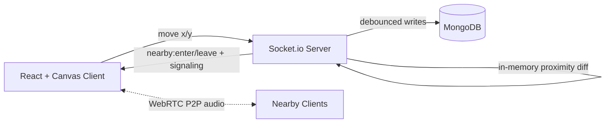

# ProxiSpeak

A 2D virtual office where voice chat depends on distance. Move your avatar around a shared map and connect by WebRTC audio only with people within earshot (100 px).

Built as a 4-person internship project at Infotact Solutions. This README separates what is **implemented and verified** from what is **planned**, so nothing here overstates the current state.

## Why

Tools like Zoom put everyone in rigid rooms. A physical office has spontaneous, overheard conversations. ProxiSpeak explores that with proximity-gated audio.

## Status

| Area | Status |
|---|---|
| Socket.IO server: join, move, leave, broadcast | Implemented |
| Server-side proximity diffing (`nearby:enter` / `nearby:leave`) at 100 px | Implemented |
| Proximity-gated WebRTC signaling (offer, answer, ICE) | Implemented |
| Glare-free offerer election (`shouldInitiateOffer`) | Implemented |
| Coordinate validation (bounds, finite numbers) | Implemented |
| Debounced MongoDB persistence + race-safe disconnect cleanup | Implemented |
| Spatial benchmark script (`audit:spatial`) | Implemented |
| React + Canvas world, avatar movement | Implemented *(confirm)* |
| P2P audio via `getUserMedia` + WebRTC | Implemented *(confirm)* |
| Distance-based volume (gain) and stereo panning | Planned *(update if merged)* |
| Obstacles/walls attenuating sound | Planned |
| Redis Pub/Sub horizontal scaling | Planned |
| MongoDB `$near` / `$geoWithin` queries for proximity | Planned (see Design Notes) |

## How It Works

1. The client sends its x/y position as the avatar moves (about 15 updates/sec).
2. The server validates the position, updates in-memory state, and broadcasts `user:moved`.
3. The server diffs each user's nearby set. When two users cross the 100 px boundary it emits `nearby:enter` or `nearby:leave` to only that pair.
4. `nearby:enter` carries `shouldInitiateOffer`, decided by comparing socket IDs lexicographically, so exactly one side creates the WebRTC offer and offer collisions (glare) are avoided.
5. Offers, answers and ICE candidates are relayed only if the server re-checks that both users are still within 100 px (`areUsersWithinEarshot`). Otherwise they are dropped.
6. Audio flows peer to peer between connected users.



## Design Notes

- **In-memory state is the source of truth for real-time behavior.** Positions and proximity are computed in memory, so movement broadcasts and proximity checks never wait on the database.
- **MongoDB stores last-known positions only.** A `2d` index exists on `position`, but live proximity is computed in memory, not with `$near`. The index is kept for persistence and for possible future queries.
- **Debounced persistence.** A client can emit 15 to 60 `move` events per second. Writes are debounced (`DB_DEBOUNCE_MS = 1000`), so only the final position after movement pauses is saved. This cuts writes by up to ~95% in the design (15 to 60 events/sec collapse to at most one write per idle second).
  - *To verify with data:* run `npm run test:clients` and compare move events received vs. `updateOne` calls.
- **Race-safe disconnect.** On disconnect the server cancels the debounce timer, marks the socket in a short-lived tombstone set, flushes any pending position, awaits in-flight writes, then deletes the document. This stops late async writes from resurrecting deleted players.

## Performance

Measured with `npm run audit:spatial`. These numbers cover **server-side in-memory computation only** (proximity lookup and clustering) on **simulated users**. They are not end-to-end audio latency and not real WebRTC load.

| Users | Proximity avg (ms) | Proximity p95 (ms) | Clustering avg (ms) | Clustering p95 (ms) |
|:--:|:--:|:--:|:--:|:--:|
| 10 | *rerun* | *rerun* | *rerun* | *rerun* |
| 25 | 0.0063 | 0.0089 | 0.0106 | 0.0120 |
| 50 | 0.0065 | 0.0091 | 0.0434 | 0.0696 |
| 100 | 0.0106 | 0.0186 | 0.2378 | 0.3553 |
| 200 | 0.0207 | 0.0317 | 0.9817 | 1.3458 |

Target: p95 under 20 ms. All measured rows are well under it.

> **Known issue:** the earlier 10-user row reported avg (0.0147 ms) above p95 (0.0097 ms), which is not possible for a correct percentile. Re-run the audit, check the percentile calculation in `spatial-audit.js`, and fill in the row before publishing.

Methodology: `docs/benchmarks.md`.

```bash
cd server && npm run audit:spatial
```

## Tech Stack

| Layer | Technology |
|---|---|
| Frontend | React, HTML5 Canvas, WebRTC (`getUserMedia`) |
| Backend | Node.js, Express, Socket.IO |
| Database | MongoDB (Mongoose), `2d` index on `position` |
| Planned | Web Audio API (gain, panning), Redis Pub/Sub with `@socket.io/redis-adapter` |

## Socket.IO Events

| Event | Direction | Payload | Description |
|---|---|---|---|
| `join` | Client → Server | `{ username?, x?, y? }` | Register in the world |
| `users:list` | Server → Client | `User[]` | Snapshot of active users, sent to the joiner |
| `user:joined` | Server → Clients | `User` | Broadcast to others when someone joins |
| `move` | Client → Server | `{ x, y }` | Validated, applied in memory, persisted with debounce |
| `user:moved` | Server → Clients | `{ socketId, id, x, y }` | Broadcast of a valid move |
| `user:left` | Server → Clients | `{ socketId }` | Broadcast on disconnect |
| `nearby:enter` | Server → pair | `{ socketId, id, username, x, y, shouldInitiateOffer }` | Pair entered 100 px earshot |
| `nearby:leave` | Server → pair | `{ socketId, id }` | Pair left earshot; close the peer connection |
| `webrtc:offer` / `webrtc:answer` / `webrtc:ice-candidate` | Client ⇄ Server | `{ targetId, ... }` | Relayed only if both peers are within 100 px |

**Validation:** coordinates must be finite numbers within `0 ≤ x ≤ 1000`, `0 ≤ y ≤ 600`. Invalid input is dropped with no state change.

## Data Model

```javascript
// server/models/Player.js
{
  playerId: String,      // socket.id, unique + indexed
  x: Number,             // default 400
  y: Number,             // default 400
  position: [Number],    // [x, y], 2d index
  lastSeen: Date
}  // timestamps: true
```

## Testing

From `server/`:

- `npm test`: persistence tests (2d index, coordinate clamping, debouncing)
- `npm run test:clients`: multi-avatar simulation with configurable client count and duration
- `npm run migrate:indexes`: ensures the `position_2d` index exists
- `npm run audit:spatial`: spatial benchmark across 10 to 200 simulated users

## Getting Started

Prerequisites: Node.js (LTS), a MongoDB Atlas account, a microphone and headphones.

```bash
git clone https://github.com/ABHAY-AVA2005/ProxiSpeak-project-Group-10--INFOTACT-.git
cd ProxiSpeak-project-Group-10--INFOTACT-
cp .env.example .env     # fill in your own values; never commit .env

cd server && npm install && npm run dev
# new terminal
cd client && npm install && npm run dev
```

Open two browser tabs or devices, join with different names, and move the avatars within 100 px of each other. Use headphones to avoid echo.

## Limitations

- Audio is a P2P mesh, which is fine for small groups in earshot but does not scale to large crowds in one radius.
- No TURN server is configured, so some restrictive networks may fail to connect.
- Benchmarks use simulated users; real concurrent audio sessions were tested at small scale only.
- Single Node instance until Redis scaling is implemented.

## Team

| Member | Role |
|---|---|
| Abhay Varshit Aripirala | Team Lead, Backend (signaling, proximity, persistence) |
| Tanvi Dighe | Frontend (Canvas world) |
| Abhishek Bhalla | Frontend (WebRTC and Web Audio) |
| Kajal Kumari Singh | Backend (MongoDB, Redis) |

Project docs: `docs/context/`.

## Note

Built for Infotact Solutions. Confidential internship information is not to be shared outside the team.
