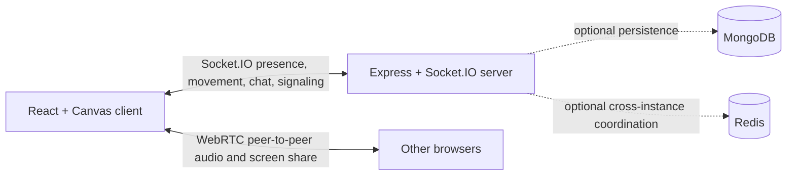

# ProxiSpeak

ProxiSpeak is a browser-based virtual office built for remote teams who want a more natural, spatial way to collaborate. Users can move through a shared office floorplan, hear coworkers who are nearby, chat by room or globally, direct-message teammates, share a screen, and coordinate meetings in one place.

## Overview

The project combines:

- a React + Vite frontend for the office UI and workspace interactions
- a Node.js + Express + Socket.IO backend for realtime presence, movement, chat, and signaling
- WebRTC for peer-to-peer proximity audio and screen sharing
- optional Redis and MongoDB integrations for shared state and persistence

## Live deployment

| Service | URL | Purpose |
|---|---|---|
| Web app | https://proxi-speak-project-group-10-infota.vercel.app/ | Frontend hosted on Vercel |
| Backend health | https://proxispeak-server-hkvz.onrender.com/health | Express and Socket.IO server health |

The production deployment is intended to show a live office experience. Health checks should confirm whether Redis is connected and whether optional persistence services are enabled for that deployment.

## Key features

- Virtual office map with rooms such as Meeting Room, Focus Zone, Open Workspace, Lounge, and Pantry
- Click-to-move navigation and keyboard movement with A* pathfinding around furniture and walls
- Proximity-based voice chat with adjustable listening distance, attenuation, and room-aware audio behavior
- Room chat and all-chat modes for team communication
- Direct messaging from the online directory
- Screen sharing and in-call controls
- Meeting scheduling with invitee management and email notifications when configured
- Live announcements, recent session history, and office-wide room selection

## Repository structure

```text
.
├── README.md
├── docker-compose.yml
├── start.bat
├── start-multi.bat
├── client/                 # React frontend
├── server/                 # Express + Socket.IO backend
├── docs/                   # Deployment, architecture, and project notes
├── scripts/                # Utility and multi-instance setup scripts
└── main.html               # Additional prototype or reference entry point
```

## Tech stack

| Area | Stack |
|---|---|
| Frontend | React 19, Vite, JavaScript, HTML, CSS |
| Backend | Node.js, Express, Socket.IO |
| Real-time media | WebRTC |
| Shared state | Redis with `ioredis` and `@socket.io/redis-adapter` |
| Persistence | MongoDB with Mongoose (optional) |
| Hosting | Vercel for frontend, Render for backend |

## Getting started

### Prerequisites

- Node.js LTS
- npm
- A modern browser with microphone access enabled for voice chat

### One-click local setup (Windows)

From the repository root, run:

```powershell
start.bat
```

This launches:

- backend on `http://localhost:5000`
- frontend on `http://localhost:5173`

### Multi-instance development

For testing a multi-server setup with two backend instances:

```powershell
start-multi.bat
```

This starts two backend processes and a single frontend instance for cluster-style testing.

### Manual startup

Terminal 1:

```powershell
Set-Location server
npm install
npm run dev
```

Terminal 2:

```powershell
Set-Location client
npm install
npm run dev
```

Then open `http://localhost:5173` in the browser.

### Optional Redis for local development

A local Redis instance can be started with Docker Compose:

```powershell
docker compose up -d
```

This starts the Redis service defined in [docker-compose.yml](./docker-compose.yml) on port `6379`.

## Environment configuration

The backend expects a `.env` file in `server/` for optional service configuration. Typical variables include:

- `PORT`
- `REDIS_ENABLED`
- `REDIS_URL` or equivalent host configuration
- `MONGODB_URI`
- `RESEND_API_KEY`
- `EMAIL_FROM`

Keep secrets in the hosting provider's environment settings rather than committing them to the repository.

## Testing and validation

Run frontend checks:

```powershell
Set-Location client
npm run build
npm run lint
```

Run backend tests:

```powershell
Set-Location server
npm test
```

Useful backend verification commands:

```powershell
npm run test:multi-instance
npm run test:clients
npm run audit:spatial
```

The multi-instance checks depend on Redis being reachable and `REDIS_ENABLED=true`.

## Architecture summary



The server coordinates presence and signaling. Audio and screen sharing are negotiated directly between browsers with WebRTC. MongoDB and Redis are optional service layers that improve persistence and multi-instance behavior.

## Project documentation

- [Deployment guide](./docs/DEPLOYMENT.md) — deployment layout, configuration, health checks, and troubleshooting
- [Project brief](./docs/context/01_PROJECT_BRIEF.md) — original goals and requirements
- [Progress log](./docs/context/06_PROGRESS_LOG.md) — project status and milestones
- [Database schema](./docs/database-schema.md) — persistence model and indexes
- [Redis scaling](./docs/REDIS_SCALING.md) — optional multi-instance design notes
- [Mid-review checklist](./docs/mid-review-checklist.md) — review and QA materials

## Notes

- Chat and presence state are primarily in-memory and may reset on restart.
- MongoDB-backed meeting scheduling is optional; without it, scheduling may fall back to temporary local memory.
- Redis enables cross-instance coordination and helps scale realtime state across server instances.
