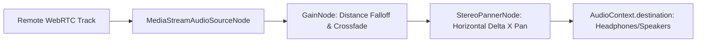

# ProxiSpeak Spatial Audio Architecture & Web Audio Pipeline

## Overview
ProxiSpeak models acoustic physics directly inside the browser using WebRTC peer-to-peer audio and the Web Audio API.

## Audio Processing Pipeline

## Mathematical Models
1. **Distance Attenuation ($G$):**
   $$G = \left(1 - \frac{\text{dist}}{100\text{px}}\right)^{1.8}$$
2. **Obstacle Raycast Damping:**
   When line segment $\overline{P_{\text{self}} P_{\text{peer}}}$ intersects wall boundaries, gain is scaled by $0.35$ (muffled room acoustics).
3. **Stereo Separation ($P$):**
   $$P = \text{clamp}\left(-1.0, 1.0, \frac{\Delta x}{100\text{px}}\right)$$