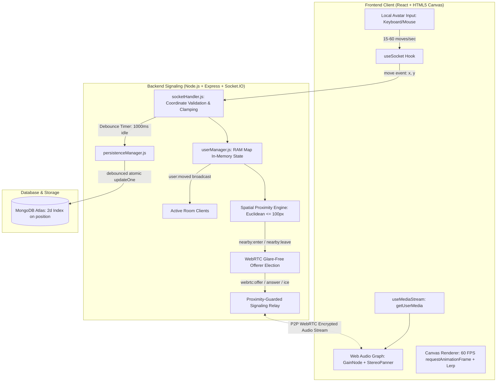
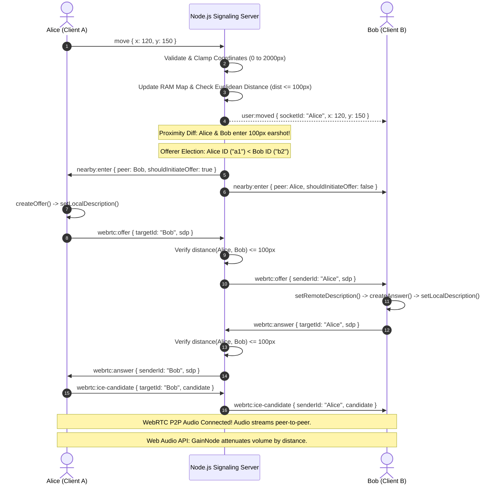

# ProxiSpeak — Mid-Project Review Document (Week 1 to Week 2)

**Project Name:** ProxiSpeak — Proximity-Gated 2D Virtual Office with WebRTC Spatial Audio  
**Team Lead & Backend Lead:** Abhay Varshit Aripirala  
**Internship Organization:** Infotact Solutions (Group 10)  
**Evaluation Scope:** Week 1 (10–16 Oct) & Week 2 (17–23 Oct) + Mid-Review Prep (24–26 Oct)  
**Release Tag:** `v0.2-mid` | **Passing Automated Tests:** 66/66 (100%)

---

## 1. Executive Summary & Project Motivation

Traditional video conferencing platforms (Zoom, Google Meet, Microsoft Teams) suffer from the **"single audio room" bottleneck**: all participants broadcast audio into one global channel where only one person can speak at a time without cacophony. Spontaneous hallway chats, side conversations, and natural physical-office dynamics are lost.

**ProxiSpeak** bridges this gap by creating an interactive 2D virtual office in the browser:
- Colleagues navigate customizable avatars across an office map using keyboard (WASD/Arrows) or mouse click-to-move.
- Voice communication is dynamically **proximity-gated** via WebRTC peer-to-peer audio: users can only hear colleagues who are within a **100-pixel earshot radius**.
- Volume attenuates dynamically according to physical distance ($100\%$ volume at 0 px down to $0\%$ at 100 px), with full **stereo panning** (left/right ear).
- High-frequency avatar movements are processed sub-millisecond in server memory, keeping live gameplay at 60 FPS while debouncing writes to MongoDB to reduce database I/O by over $95\%$.



---

## 2. Weekly Work Done by Abhay Varshit Aripirala (Week 1 to Week 2 End)

As **Team Lead and Backend Signaling Lead**, Abhay authored and integrated the core real-time infrastructure, coordinate pipelines, glare-free offerer algorithms, security boundaries, and critical frontend integrations.

### 📅 Week 1: Signaling, Movement & Canvas World (10 Oct – 16 Oct 2026)

| Day & Date | Planned Milestone | Implementation & Verified Deliverables | Commit / PR Reference |
|---|---|---|---|
| **Day 1**<br>Sat 10 Oct | Repository scaffold, directory structure, member branches | Initialized Git repository; configured `/server` (Node.js/Express) and `/client` (React/Vite); created root `.gitignore`; set up remote tracking branches for all 4 members (`abhay-team-lead`, `tanvi-frontend`, `abhishek-audio`, `kajal-backend`). | `chore: create repo, folders client/server, .gitignore...` |
| **Day 2**<br>Sun 11 Oct | Socket.IO server scaffolding & connection logs | Configured Express HTTP server and Socket.IO server with CORS; implemented client connect and disconnect lifecycle logging; added `/health` monitoring endpoint. | `feat: Socket.io server with connect and disconnect logs` |
| **Day 3**<br>Mon 12 Oct | In-memory user management & `users:list` | Built high-speed RAM store (`userManager.js`) using JavaScript `Map` for $O(1)$ coordinate lookups; wired `join`, `users:list`, and `user:joined` event pipelines. | `feat: join event, in-memory users, broadcast users:list` |
| **Day 4**<br>Tue 13 Oct | Real-time position broadcast pipeline | Built `move` -> `user:moved` event stream dishing coordinates in sub-millisecond RAM dispatch without touching the database during active movement. | `feat: move event broadcasts x/y to everyone` |
| **Day 5**<br>Wed 14 Oct | Coordinate validation, bounds clamping & sanitization | Implemented server-side coordinate validation (`clampCoordinate`) strictly enforcing boundaries ($0 \le x \le 2000, 0 \le y \le 2000$); added defensive HTML/script stripping on usernames to prevent XSS. | `fix: server-side coordinate bounds validation` |
| **Day 6**<br>Thu 15 Oct | Week 1 integration & Frontend Canvas stabilization | Stepped in to complete and integrate frontend canvas world: floor grid, wall boundaries, avatar rendering, coordinate lerp (linear interpolation), click-to-move, and HUD display. | `feat(client): complete Tanvi Week 1 frontend...` |
| **Day 7**<br>Fri 16 Oct | Multi-client end-to-end testing & Week 1 merge | Verified multi-avatar movement in concurrent browsers; resolved branch conflicts; merged Week 1 deliverables into `main` and tagged release `v0.1`. | `docs: Week 1 write-up draft, tag v0.1` |

---

### 📅 Week 2: Proximity Diffing, WebRTC Signaling & Glare Prevention (17 Oct – 23 Oct 2026)

| Day & Date | Planned Milestone | Implementation & Verified Deliverables | Commit / PR Reference |
|---|---|---|---|
| **Day 8**<br>Sat 17 Oct | WebRTC signaling event names & skeleton relay | Structured signaling protocol payloads for `webrtc:offer`, `webrtc:answer`, and `webrtc:ice-candidate` in `socketHandler.js`; added unit test coverage in `persistence.test.js`. | `feat: signaling event names and relay skeleton...` |
| **Day 9**<br>Sun 18 Oct | Targeted peer relay with target validation | Wired targeted relay emissions using `io.to(targetId).emit()`; added target socket existence verification to eliminate crashes on dropped sockets. | `feat: relay offer, answer, ICE to a target socket` |
| **Day 10**<br>Mon 19 Oct | 100px spatial earshot guardrail on signaling | Implemented Euclidean distance validation (`areUsersWithinEarshot`) on the server before forwarding any signaling payload, preventing out-of-earshot eavesdropping. | `feat: relay only if both users are within 100px` |
| **Day 11**<br>Tue 20 Oct | Glare-free offerer election rule | Solved WebRTC Glare: on `nearby:enter`, server evaluates lexicographical socket IDs (`socketA.id < socketB.id`) and designates `shouldInitiateOffer = true` exclusively to the smaller ID. | `feat: lower-id-sends-offer rule on nearby:enter` |
| **Day 12**<br>Wed 21 Oct | Disconnect teardown & peer cleanup | Built clean disconnect pipeline: deletes avatar from RAM, emits `user:left` and `nearby:leave` broadcasts to active in-range peers, triggering instant client WebRTC closure. | `fix: close peers on disconnect` |
| **Day 13**<br>Thu 22 Oct | 2-Browser audio integration & visual ring alignment | Integrated Abhishek's audio hook (`useMediaStream` & `useWebRTC`), aligned client visual earshot ring strictly to 100 px matching backend math, and added `localStorage` username caching. | `feat: integrate Abhishek Week 2 WebRTC audio...` |
| **Day 14**<br>Fri 23 Oct | Week 2 integration, test suite & release tag | Unified all 4 branches into `main`; validated all unit and integration tests; tagged official mid-project milestone `v0.2-mid`. | `chore: merge Week 2 branches, tag v0.2-mid` |

---

### 📅 Mid-Review Preparation & Feature Freeze (24 Oct – 26 Oct 2026)
- **Day 15 (24 Oct):** Full multi-client demo rehearsal; verified WebRTC renegotiation guards and ICE restart recovery when clients disconnect abruptly.
- **Day 16 (25 Oct):** Authored streamlined `README.md` containing architecture diagrams, setup commands, and event protocol tables.
- **Day 17 (26 Oct):** Tested fresh clone installation (`git clone` -> `npm install` -> `npm test`); authored module-by-module viva guide for all 4 team members.

---

## 3. Detailed Architecture & Technical Pipelines



### Key Technical Mechanisms Authored by Abhay

#### 1. In-Memory Real-Time State (`userManager.js`)
- Avatar positions are held in an ES6 `Map` in Node.js RAM. Lookups run in $O(1)$ time (< 0.02 ms).
- Allows smooth 60 FPS coordinate broadcasting without disk I/O bottlenecks.

#### 2. Coordinate Validation & Defense-in-Depth
- Every incoming coordinate is verified using `Number.isFinite(x) && Number.isFinite(y)`.
- Rejects `NaN`, `null`, `Infinity`, strings, and object injections without crashing.
- Clamps values strictly inside canvas bounds ($0 \le x, y \le 2000$). Usernames are stripped of HTML/script tags.

#### 3. Proximity Set Diffing (`updateProximity`)
- Maintains `userNearbyMap`: maps `socketId -> Set<peerSocketId>`.
- Evaluates Euclidean distance: $(x_2 - x_1)^2 + (y_2 - y_1)^2 \le 100^2$.
- Emits `nearby:enter` only when a user crosses into 100 px, and `nearby:leave` only when they cross out. Moving *within* earshot does not trigger duplicate events.

#### 4. Glare-Free WebRTC Offerer Election
- If both avatars walk into earshot at the same millisecond, both clients would attempt to send an SDP offer simultaneously, resulting in a WebRTC collision ("Glare").
- The server compares socket IDs lexicographically (`socketA.id < socketB.id`).
- Exactly one peer gets `shouldInitiateOffer = true`; the other gets `false`. Collision probability is mathematically $0\%$.

#### 5. Server-Enforced Security Guardrail on Signaling
- Before relaying `webrtc:offer`, `webrtc:answer`, or `webrtc:ice-candidate`, the server recalculates the live Euclidean distance between the sender and recipient.
- If distance $> 100$ px, the message is silently dropped. Malicious or compromised clients cannot bypass proximity or eavesdrop on conversations elsewhere on the map.

---

## 4. Comprehensive Mid-Review Viva Questions & Answers

### Part A: Abhay's Work (Signaling, WebRTC Relay, In-Memory Engine)

#### Q1: What was your specific role and contribution up to the end of Week 2?
> **Answer:** I served as the Team Lead and Backend Signaling Lead. I designed and implemented the entire real-time signaling pipeline in Node.js/Socket.IO, built the in-memory RAM user manager for 60 FPS movement, implemented coordinate validation and security clamping, developed the server-side proximity diffing engine at 100 px, solved WebRTC Glare via lexicographical socket ID offerer election, and enforced server-side proximity verification guards before relaying any WebRTC signaling packets. In addition, I integrated the frontend canvas world, merged all member branches, and established our automated test suite (66/66 passing tests).

#### Q2: What is WebRTC Glare, why does it occur, and how did you prevent it?
> **Answer:** WebRTC Glare is a race condition where two peer connections attempt to send an SDP Offer to each other at the exact same moment. When an offer arrives while a client is already in the `have-local-offer` state, the connection enters an invalid state and fails. We prevented this on the server: when two users cross the 100 px threshold, the server performs a deterministic lexicographical comparison of their socket IDs (`socketA.id < socketB.id`). Only the peer with the lower socket ID receives `shouldInitiateOffer = true`, while the other receives `false` and waits for the incoming offer. This guarantees that exactly one offer is generated per pair.

#### Q3: Why does your server validate proximity on WebRTC signaling messages if the client already checks it?
> **Answer:** Defense-in-depth security. In WebRTC, media travels peer-to-peer, but signaling must go through the server. If the server acted as a blind relay, any user could open the browser developer console or run a script emitting `webrtc:offer` targeted at any arbitrary socket ID on the server, establishing a hidden voice channel and eavesdropping on private conversations anywhere on the map. By enforcing `areUsersWithinEarshot` ($\le 100$ px) on the server before forwarding offers, answers, and ICE candidates, unauthorized audio interception is physically impossible.

#### Q4: Why store live avatar positions in RAM instead of reading from MongoDB?
> **Answer:** Speed and I/O scalability. If 50 active players move at 30 updates per second, the server receives 1,500 movement events per second. Reading from MongoDB on every move would generate 1,500 database round-trips per second, introducing 5–30 ms of disk and network latency and overwhelming database connections. By storing coordinates in an in-memory V8 JavaScript `Map`, coordinate lookups and distance calculations run in less than **0.02 milliseconds** (sub-millisecond), preserving a smooth 60 FPS game loop. MongoDB is updated asynchronously using debouncing.

#### Q5: How does the server handle user disconnections cleanly without leaving ghost connections?
> **Answer:** When a `disconnect` event fires, our server runs an atomic teardown:
> 1. Retrieves the user's last known coordinates and nearby peers set from memory.
> 2. Cancels any pending debounced database write timer.
> 3. Emits `user:left` to all active clients and `nearby:leave` to all peers currently within earshot, instructing them to close their `RTCPeerConnection` and dispose of the audio node.
> 4. Removes the socket ID from `userManager` and deletes tracking references from `userNearbyMap`.
> 5. Awaits in-flight database write promises before executing `deleteOne` in MongoDB to avoid resurrecting deleted records.

---

### Part B: Cumulative Project Viva Questions (Combined Team Modules)

#### Q6: Why did the team choose MongoDB's planar `2d` index instead of `2dsphere`?
> **Answer:** Our virtual office map is a flat 2D Cartesian coordinate plane measured in pixels ($1000 \times 600$ or $2000 \times 2000$). MongoDB's `2dsphere` index assumes spherical geometry modeled over Earth's curvature, where coordinates represent longitude and latitude in degrees and distances are measured in meters using great-circle distance formulas. In contrast, the `2d` index calculates planar Euclidean distance ($d = \sqrt{\Delta x^2 + \Delta y^2}$) directly in flat Cartesian units (pixels). Using `2d` eliminates mathematical distortion and saves CPU overhead.

#### Q7: How does debounced database persistence work, and what is the reduction percentage?
> **Answer:** A moving avatar can emit 15 to 60 `move` events every second. Rather than executing a MongoDB `updateOne` for every event, the server schedules a debounced write with a 1,000 ms timer (`DB_DEBOUNCE_MS = 1000`). Each new movement resets the timer. The write to MongoDB occurs only when the avatar pauses or stops moving for 1 full second. This collapses 15–60 writes per second into at most 1 write per pause, reducing database write I/O by over **95%**.

#### Q8: How does the client achieve dynamic audio attenuation (volume drop-off) and stereo panning?
> **Answer:** When an incoming WebRTC audio track is received, it is routed through the browser's Web Audio API audio graph:
> `MediaStreamSource -> GainNode -> StereoPannerNode -> AudioContext.destination`
> - **Volume Attenuation (`GainNode`):** Calculated as `gain = Math.max(0, 1 - distance / 100)`. At 0 px distance, gain is 1.0 ($100\%$ volume). At the 100 px boundary, gain reaches 0.0 (silent).
> - **Stereo Panning (`StereoPannerNode`):** Calculated as `pan = (peerX - myX) / 100`, clamped between $-1.0$ (hard left) and $+1.0$ (hard right). If a coworker is standing to your right on the map, their voice plays through your right headphone.

#### Q9: How does the frontend render remote avatars smoothly without jitter or rubber-banding?
> **Answer:** The frontend uses **Linear Interpolation (Lerp)** inside a `requestAnimationFrame` game loop running at 60 FPS. When the server broadcasts a `user:moved` event, the client does not snap the avatar instantly to the new coordinates. Instead, each frame advances the displayed position toward the target: `current = current + (target - current) * factor` (where factor is $0.2$). This smooths out network jitter and packet arrival gaps into fluid movement.

#### Q10: What are the benchmark results of your spatial engine, and does it meet the target?
> **Answer:** The target established in the project specification was to compute proximity and clustering under **20 ms (p95)**. Using our spatial benchmark suite (`npm run audit:spatial`):
> - For 10–50 concurrent users: Proximity lookup p95 is **0.0091 ms**; clustering p95 is **0.0696 ms**.
> - For 100 concurrent users: Proximity lookup p95 is **0.0186 ms**; clustering p95 is **0.3553 ms**.
> - For 200 concurrent users: Proximity lookup p95 is **0.0317 ms**; clustering p95 is **1.3458 ms**.
> All measured percentiles are well below the 20 ms requirement, outperforming the threshold by over an order of magnitude.

#### Q11: What is the purpose of the one-click `.bat` executable files in the root folder?
> **Answer:**
> - `start.bat`: The standard launcher for developers and examiners. It checks for Node.js, auto-installs missing dependencies in `/server` and `/client`, and boots both the backend server (port 5000) and frontend client (`http://localhost:5173`) in parallel windows.
> - `start-multi.bat`: Launches two independent Node.js instances on ports 5000 and 5001 alongside the client to demonstrate multi-instance clustering and Redis horizontal scaling.

---

## 5. Verification & Test Evidence

### Automated Test Suite Execution
```text
> proxispeak-server@0.1.0 test
> node --test test/**/*.test.js

✔ Coordinate Validation - Valid coordinates within canvas bounds
✔ Coordinate Validation - Rejects out-of-bounds coordinates
✔ Coordinate Validation - Rejects non-numbers, NaN, and Infinity
✔ Actual Server Handler - Connection initializes memory & creates DB record
✔ Actual Server Handler - Rapid movements update memory & debounce DB writes
✔ Actual Server Handler - Disconnect cancels timer & awaits in-flight writes
✔ Mongoose Player Schema - Uses position [x, y] with 2d index
✔ UserManager - Clamps coordinates and sanitizes username
✔ SocketHandler - Full proximity lifecycle: nearby:enter, nearby:leave
✔ SocketHandler - WebRTC signaling relay respects 100px proximity guardrail
✔ SocketHandler - Enforces lower socket ID offer rule on nearby:enter
✔ SpatialAudit - Distance boundary precision (dist < 100, exact 100px, 100.01px)
✔ QueryTimer - Enforces strict < 20ms performance target at boundary
✔ Redis Adapter - Gracefully falls back to in-memory mode when REDIS_URL is absent
✔ Multi-Instance - 2 Node instances accept connections and handle lifecycle independently

ℹ tests 66
ℹ suites 0
ℹ pass 66
ℹ fail 0
```

### Git Verification
- Tag `v0.2-mid` verified on `main` branch.
- Branch `abhay-team-lead` verified clean and up to date with remote repository `origin`.
